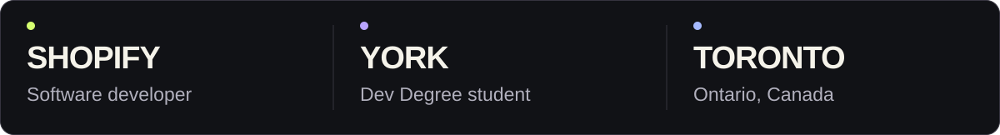
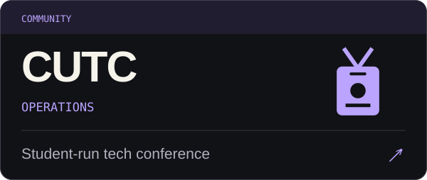
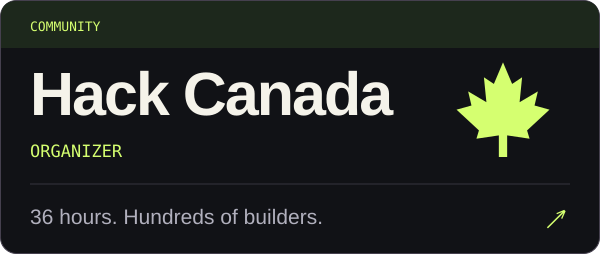
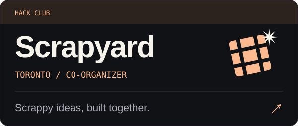
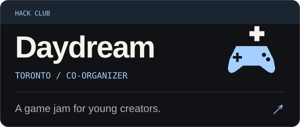

  <a href="https://ritvikgoyal.com"><b>The portfolio ↗</b></a> &nbsp; / &nbsp;
  <a href="https://app.ritvikgoyal.com"><b>Enter the playground ↗</b></a> &nbsp; / &nbsp;
  <a href="https://www.linkedin.com/in/ritvikgoyal1/">LinkedIn</a> &nbsp; / &nbsp;
  <a href="mailto:connect@ritvikgoyal.com">Say hello</a>

<picture>
  <source media="(max-width: 600px)" srcset="assets/identity-mobile.svg" />
  
</picture>

### Building the community, too.

  <a href="https://cutc.ca/"><picture><source media="(max-width: 600px)" srcset="assets/cutc-mobile.svg" /></picture></a>
  <a href="https://hackcanada.org/"><picture><source media="(max-width: 600px)" srcset="assets/hack-canada-mobile.svg" /></picture></a>

  <a href="https://scrapyard.hackclub.com/toronto"><picture><source media="(max-width: 600px)" srcset="assets/scrapyard-mobile.svg" /></picture></a>
  <a href="https://daydream.hackclub.com/toronto"><picture><source media="(max-width: 600px)" srcset="assets/daydream-mobile.svg" /></picture></a>

### Selected builds.

<a href="https://app.ritvikgoyal.com/projects/dealify"><picture><source media="(max-width: 600px)" srcset="assets/dealify.svg" /></picture></a>

<b>Winner, Shopify: Hack Shopping with AI</b> · Hack the North 2026. Built with Bryan Maristanez and Ricardo Gao.

<a href="https://github.com/Maristanez/dealify">Source ↗</a> · <a href="https://devpost.com/software/bazaar-wgv16i">The hack ↗</a> · <a href="https://app.ritvikgoyal.com/projects/dealify#demo">Watch it ↗</a>

 

<a href="https://wealthsnaps.com"><picture><source media="(max-width: 600px)" srcset="assets/wealthsnaps.svg" /></picture></a>

<b>In development</b> · React Native / Expo / Gemini / Supabase

<a href="https://wealthsnaps.com">Explore ↗</a> · <a href="https://app.ritvikgoyal.com/projects/wealthsnaps">Build notes ↗</a>

 

<a href="https://dazzling-licorice-53acc6.netlify.app"><picture><source media="(max-width: 600px)" srcset="assets/studyflow.svg" /></picture></a>

<a href="https://dazzling-licorice-53acc6.netlify.app">Try it ↗</a> · <a href="https://app.ritvikgoyal.com/projects/studyflow">Build notes ↗</a>

 

<a href="https://panther-press.pages.dev"><picture><source media="(max-width: 600px)" srcset="assets/panther-press.svg" /></picture></a>

<a href="https://panther-press.pages.dev">Read it ↗</a> · <a href="https://github.com/vpci-panther-press/panther-press">Source ↗</a>

  
<b>A few more things about me</b>

   
  <ul>
    <li>STEM Camp counselor, summer 2024.</li>
    <li>CALICO bronze, December 2024.</li>
    <li>Built <a href="https://github.com/STEM-E-Youth-Career-Development-Program/map-app">mapSTEM</a> to help students find STEM opportunities.</li>
    <li>Started with Python, a website, and a Pygame game in 2022. First internship at STEM·E and first hackathon at AmberHacks in 2023.</li>
  </ul>
  
<a href="https://ritvikgoyal.com/#sig-story">More of the story ↗</a> · <a href="https://ritvikgoyal.com/resume">Résumé ↗</a>

 

