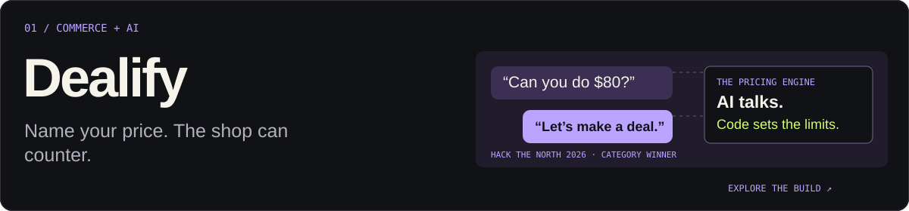
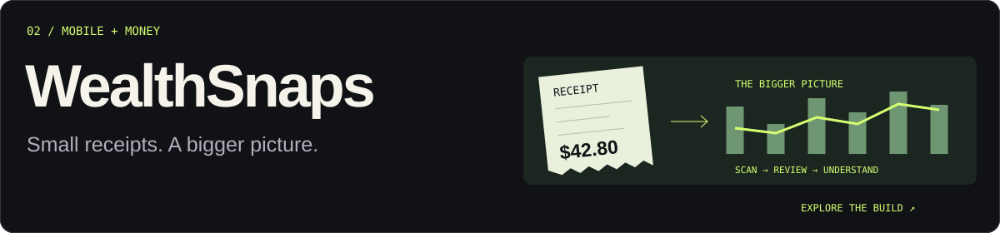
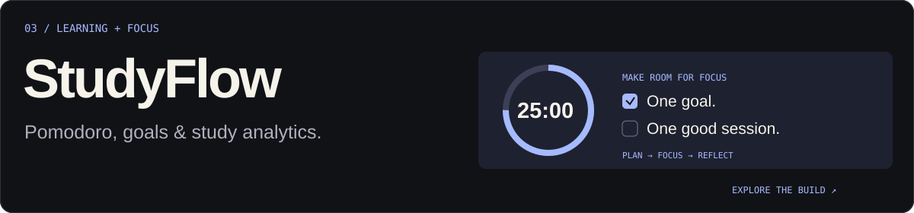
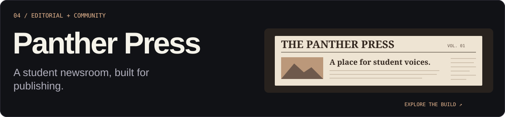

  <a href="https://ritvikgoyal.com"><b>The portfolio ↗</b></a> &nbsp; / &nbsp;
  <a href="https://app.ritvikgoyal.com"><b>Enter the playground ↗</b></a> &nbsp; / &nbsp;
  <a href="https://www.linkedin.com/in/ritvikgoyal1/">LinkedIn</a> &nbsp; / &nbsp;
  <a href="mailto:connect@ritvikgoyal.com">Say hello</a>

### I build software. And bring people together.

I'm Ritvik, a **software developer at Shopify** and a **Digital Technologies student at York University** through [Dev Degree](https://devdegree.ca/), based in Toronto.

I like the moment an idea stops being a “what if” and becomes something someone can use. Sometimes that’s a shopkeeper that negotiates. Sometimes it’s a better way to study. Sometimes it’s a room full of people building their first weird thing.

### Building the community, too.

**CUTC and Hack Canada are two of the biggest parts of my story.** I care about bringing people into the room, giving them a reason to connect, and helping make the whole thing happen.

- **[CUTC · Operations](https://cutc.ca/):** Part of the team behind the Canadian Undergraduate Technology Conference, helping bring students, founders, researchers, and industry leaders together through student-run tech events.
- **[Hack Canada · Organizer](https://hackcanada.org/):** Helped organize [Hack Canada 2026](https://hack-canada-2026.devpost.com/), a 36-hour hackathon at Waterloo’s SPUR Innovation Centre that brought hundreds of student builders together.
- **[Scrapyard Toronto](https://scrapyard.hackclub.com/toronto):** Helped lead a Hack Club hackathon where students turned scrappy, creative ideas into projects.
- **[Daydream Toronto](https://daydream.hackclub.com/toronto):** Helped organize Hack Club’s Toronto game jam, bringing students together to build and share their own games.

### A few rabbit holes, made real.

<a href="https://app.ritvikgoyal.com/projects/dealify">
  <picture>
    <source media="(max-width: 600px)" srcset="assets/dealify.svg" />
    
  </picture>
</a>

A shopper makes an offer. AI handles the conversation; a TypeScript engine keeps every counter within the merchant’s rules.

<b>Winner, Shopify: Hack Shopping with AI</b> · Hack the North 2026. Built with Bryan Maristanez and Ricardo Gao.

<a href="https://github.com/Maristanez/dealify">Source ↗</a> · <a href="https://devpost.com/software/bazaar-wgv16i">The hack ↗</a> · <a href="https://app.ritvikgoyal.com/projects/dealify#demo">Watch it ↗</a>

 

<a href="https://wealthsnaps.com">
  <picture>
    <source media="(max-width: 600px)" srcset="assets/wealthsnaps.svg" />
    
  </picture>
</a>

Scan a receipt, review the details, and see the bigger picture. Expenses, statement imports, and net worth in one mobile app.

<b>In development.</b> React Native, Expo, Gemini receipt extraction, and Supabase.

<a href="https://wealthsnaps.com">Explore ↗</a> · <a href="https://app.ritvikgoyal.com/projects/wealthsnaps">Build notes ↗</a>

 

<a href="https://dazzling-licorice-53acc6.netlify.app">
  <picture>
    <source media="(max-width: 600px)" srcset="assets/studyflow.svg" />
    
  </picture>
</a>

A study plan only helps if it meets you at the desk. Pomodoro sessions, goals, calendars, and learning analytics in one workspace.

<a href="https://dazzling-licorice-53acc6.netlify.app">Try it ↗</a> · <a href="https://app.ritvikgoyal.com/projects/studyflow">Build notes ↗</a>

 

<a href="https://panther-press.pages.dev">
  <picture>
    <source media="(max-width: 600px)" srcset="assets/panther-press.svg" />
    
  </picture>
</a>

A home for student voices, with article search, issue archives, and a publishing workflow. Built with Astro, React, MDX, and Keystatic.

<a href="https://panther-press.pages.dev">Read it ↗</a> · <a href="https://github.com/vpci-panther-press/panther-press">Source ↗</a>

### More than the commit history.

- **Teaching:** Spent summer 2024 guiding hands-on activities as a STEM Camp counselor.
- **Problem solving:** CALICO bronze, December 2024. Still following the next interesting problem.
- **An earlier rabbit hole:** [mapSTEM](https://github.com/STEM-E-Youth-Career-Development-Program/map-app), connecting students with STEM opportunities.

  
<b>Open one more side quest.</b>

   
  
In 2022, I was learning Python, building my first website and a Pygame game, and winning a TCS goIT monthly competition. In 2023, I joined STEM·E for my first software development internship and went to my first hackathon, AmberHacks.

  
The thread through it all: follow a question, make something of it, bring a few people along.

  
<a href="https://ritvikgoyal.com/#sig-story">Follow the rest of the story ↗</a>

 

  A problem worth solving. A hackathon worth losing sleep over. An idea that won’t leave you alone. 
  <a href="mailto:connect@ritvikgoyal.com"><b>Let’s make something of it.</b></a>

